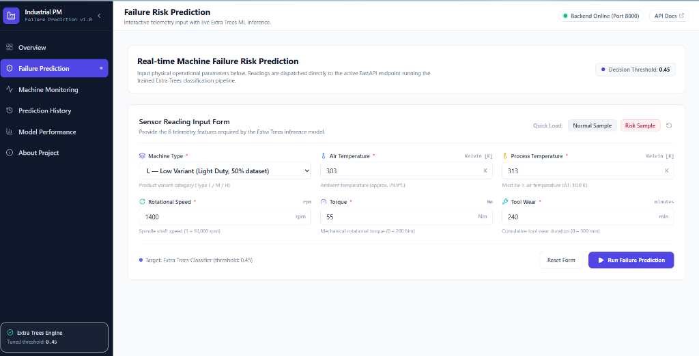
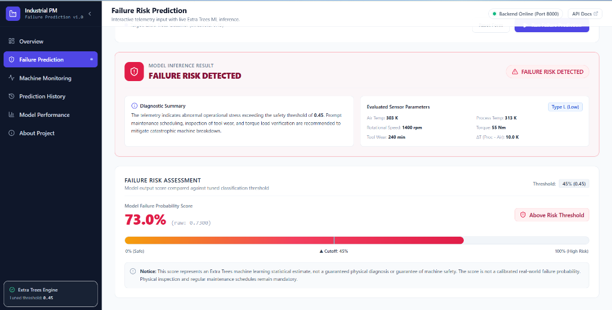
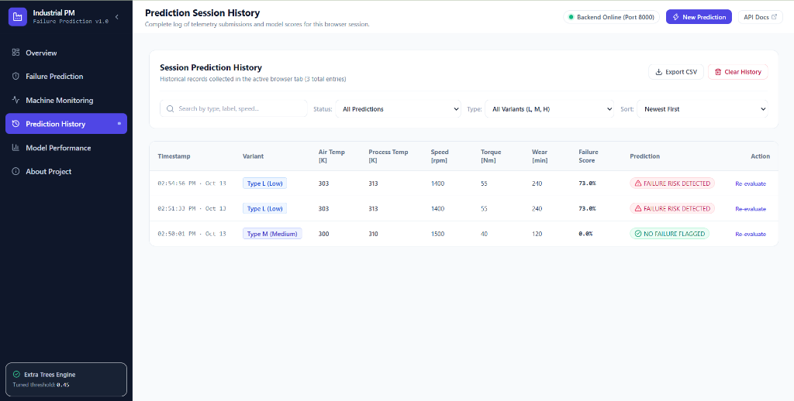
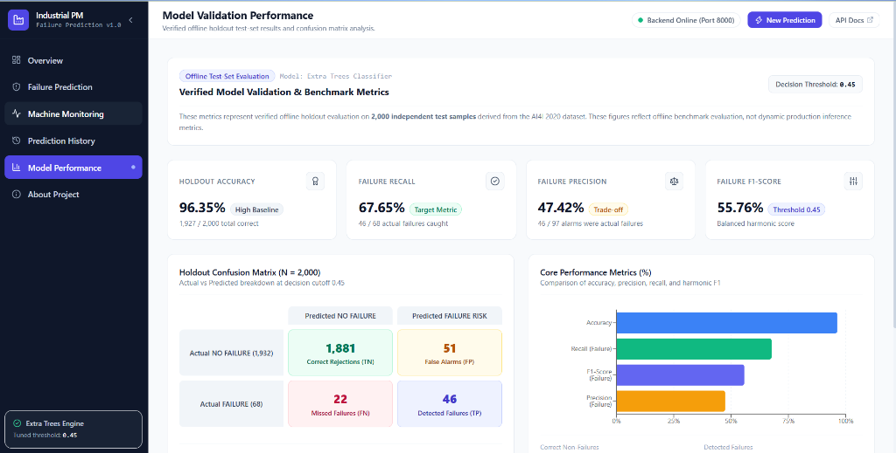
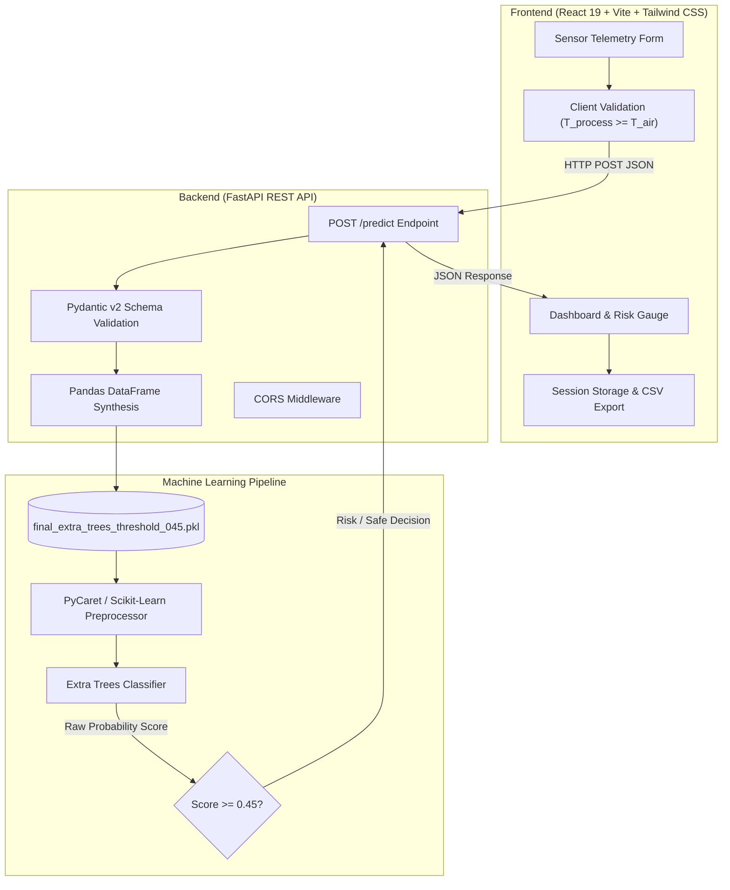

# Industrial Equipment Failure Prediction System


An end-to-end predictive maintenance system that processes machine sensor telemetry through a trained **Extra Trees Classifier** to detect industrial equipment failure risk before breakdown occurs. Features a high-performance **FastAPI** REST backend and a modern, responsive **React 19 + Tailwind CSS** dashboard.

---

## Table of Contents

- [Project Overview](#project-overview)
- [Key Features](#key-features)
- [Application Screenshots](#application-screenshots)
- [System Architecture](#system-architecture)
- [Technology Stack](#technology-stack)
- [Dataset and Features](#dataset-and-features)
- [Machine Learning Workflow](#machine-learning-workflow)
- [Model Evaluation](#model-evaluation)
- [API Documentation](#api-documentation)
- [Installation and Local Setup](#installation-and-local-setup)
- [Testing Examples](#testing-examples)
- [Project Structure](#project-structure)
- [Limitations and Future Improvements](#limitations-and-future-improvements)
- [Author and License](#author-and-license)

---

## Project Overview

In industrial manufacturing, unplanned machine breakdowns cause substantial financial losses, scrap parts, and safety hazards. Conventional maintenance approaches typically rely either on **reactive maintenance** (running equipment until failure occurs) or **rigid preventive maintenance** (servicing machines on fixed calendar schedules regardless of actual physical wear).

**Predictive maintenance (PdM)** uses sensor telemetry—including rotational speed, torque loads, thermal gradients, and cumulative tool wear—to estimate failure risk based on actual operating stress.

### Project Objective
The objective of this project is to build an end-to-end predictive maintenance application that:
1. Validates physical sensor parameters against operational constraints.
2. Generates real-time failure risk predictions via a serialized Extra Trees classification pipeline.
3. Compares model probability scores against an empirically tuned decision threshold of **`0.45`** to prioritize minority-class failure detection.
4. Delivers an industrial SaaS dashboard for engineers to evaluate equipment, inspect session logs, and review held-out model validation metrics.

> **Operational Scope Notice:** This application processes manually submitted telemetry and benchmark samples through a local API. It does not connect to live streaming factory IoT sensors or OPC-UA brokers.

---

## Key Features

- **Six-Feature Sensor Input Form:** Interactive parameter input covering product variant (`L`, `M`, `H`), ambient air temperature, process temperature, rotational speed, torque, and cumulative tool wear.
- **Physical Consistency Validation:** Client-side and server-side validation enforcing domain constraints, such as ensuring process temperature meets or exceeds ambient air temperature ($T_{\text{process}} \ge T_{\text{air}}$).
- **Extra Trees Classification Engine:** Evaluates non-linear feature interactions and high-variance telemetry using an ensemble tree pipeline.
- **Tuned Decision Threshold (`0.45`):** Adjusted cutoff optimized on validation data to capture equipment failure risks in heavily imbalanced data.
- **Visual Risk Gauge & Status Badges:** Displays failure probability percentages, raw model output scores, threshold markers, and diagnostic recommendations (`FAILURE RISK DETECTED` vs `NO FAILURE FLAGGED`).
- **Live Backend Connection Monitoring:** Real-time health polling (`GET /`) displaying connection status directly in the navigation bar.
- **Session-Based Prediction History:** Logs telemetry submissions during the browser session with search, status filtering, variant filtering, and column sorting.
- **CSV Telemetry Export:** One-click download of session predictions for local analysis.
- **Machine Variant Benchmarks:** Pre-configured telemetry profiles for Variants L, M, and H with quick-load capabilities into the prediction form.
- **Offline Model Validation View:** Displays held-out test-set metrics, an interactive $2 \times 2$ confusion matrix, and a performance chart.

---

## Application Screenshots

### 1. Sensor Telemetry Input Form
The primary inference interface showing the six physical parameters, quick-load sample presets, and the live FastAPI connection badge.



---

### 2. Failure Risk Assessment Result
Visual diagnostic card generated after running inference on a high-risk sample, showing a **73.0%** failure score exceeding the **45% (0.45)** decision cutoff.



---

### 3. Prediction Session History
Tabular history tracking inference runs during the active browser session, featuring status filters, variant filters, search, and CSV export.



---

### 4. Held-Out Model Validation Performance
Offline test-set evaluation results on 2,000 independent samples, displaying accuracy, recall, precision, F1-score, and the confusion matrix.



---

## System Architecture

The application cleanly separates the machine learning inference backend from the user presentation layer:



### Architectural Separation
- **Frontend Layer:** Built with React 19 and Vite. Handles form state, parameter formatting (Kelvin, rpm, Nm, minutes), client-side range guards, and session storage. It communicates with the backend exclusively via asynchronous HTTP requests.
- **Backend Layer:** Powered by FastAPI and Uvicorn. Exposes REST endpoints (`GET /`, `POST /predict`), validates incoming payloads against Pydantic schemas, converts inputs into Pandas DataFrames, and coordinates pipeline execution.
- **Inference Pipeline:** A pre-fitted PyCaret/scikit-learn pipeline loaded into memory once at application startup to eliminate per-request model loading overhead.

---

## Technology Stack

| Technology | Category | Role in Project |
|---|---|---|
| **Python 3.11** | Core Language | Backend API runtime and machine learning model development |
| **FastAPI** (`0.143.0`) | Backend Framework | High-performance REST API with automatic OpenAPI documentation |
| **Uvicorn** (`0.54.0`) | ASGI Server | Asynchronous web server hosting the FastAPI application |
| **PyCaret** (`3.3.2`) | ML Automation | Model experiment tracking, preprocessing pipeline assembly, and serialization |
| **scikit-learn** (`1.4.2`) | Machine Learning | Extra Trees Classifier training, threshold tuning, and holdout evaluation |
| **pandas** (`2.1.4`) | Data Processing | Data cleaning, DataFrame conversion, and holdout set management |
| **NumPy** (`1.26.4`) | Numerical Computing | Vectorized array operations and threshold grid generation |
| **React** (`19.2.8`) | Frontend Library | Component architecture, application state, and view routing |
| **Vite** (`8.3.0`) | Build Tool | Fast local development server and optimized production asset bundler |
| **Tailwind CSS** (`3.4.19`) | Styling | Utility-first responsive styling and custom industrial color scheme |
| **Recharts** (`3.10.1`) | Data Visualization | Interactive bar charts and session ratio pie charts |
| **Lucide React** (`1.56.0`) | UI Icons | Modern iconography across navigation, cards, and status alerts |

---

## Dataset and Features

The model is trained on the **AI4I 2020 Predictive Maintenance Dataset**, sourced from the [UCI Machine Learning Repository](https://archive.ics.uci.edu/dataset/601/ai4i+2020+predictive+maintenance+dataset). The dataset contains 10,000 synthetic observations reflecting realistic milling machine operations.

### Model Input Features

| Feature Name | Raw Column Name | Unit / Range | Description |
|---|---|---|---|
| **Machine Type** | `Type` | `L`, `M`, `H` | Product variant quality: Low (50%), Medium (30%), High (20%) |
| **Air Temperature** | `Air temperature [K]` | $250 - 350\text{ K}$ | Ambient room temperature |
| **Process Temperature** | `Process temperature [K]` | $250 - 400\text{ K}$ | Temperature generated during milling ($T_{\text{process}} \ge T_{\text{air}}$) |
| **Rotational Speed** | `Rotational speed [rpm]` | $1 - 10,000\text{ rpm}$ | Spindle motor rotational frequency |
| **Torque** | `Torque [Nm]` | $0 - 200\text{ Nm}$ | Mechanical rotational torque |
| **Tool Wear** | `Tool wear [min]` | $0 - 300\text{ min}$ | Cumulative machining duration on cutting tool |

- **Target Variable:** `Machine failure` (`0` = No Failure, `1` = Failure Risk).

### Data Preprocessing and Leakage Prevention
During initial data preparation (`src/preprocessing.py`):
1. **Duplicate Removal:** Checked and confirmed zero duplicate records.
2. **Identifier Removal:** Dropped non-predictive keys (`UDI`, `Product ID`).
3. **Leakage Prevention:** Dropped specific failure mode flags (`TWF`, `HDF`, `PWF`, `OSF`, `RNF`). These columns represent direct diagnostic indicators that are only known *after* a failure occurs. Retaining them would cause artificial data leakage.
4. **Stratified Partitioning:** Split data into **80% training** (8,000 samples) and **20% testing** (2,000 samples) with stratified class ratios matching the 3.4% failure prevalence.

---

## Machine Learning Workflow

```text
1. Exploratory Data Analysis (src/01_data_understanding.py, src/02_eda.py)
   ├── Missing value verification & summary distributions
   └── Class imbalance identification (3.4% positive failure rate)
       │
2. Preprocessing & Leakage Removal (src/preprocessing.py)
   ├── Drop UDI, Product ID, and failure mode flags (TWF, HDF, PWF, OSF, RNF)
   └── Stratified train/test split (80% train = 8,000 / 20% test = 2,000)
       │
3. Model Comparison & Selection (src/compare_models.py, src/compare_rf_et.py)
   ├── Evaluated multiple algorithms (Logistic Regression, Random Forest, Extra Trees)
   └── Extra Trees selected for lower variance and superior minority recall
       │
4. Threshold Tuning on Validation Split (src/tune_threshold.py)
   ├── Partitioned training set into 6,400 fit / 1,600 validation rows
   ├── Evaluated thresholds from 0.10 to 0.60 in steps of 0.05
   └── Selected threshold = 0.45 to optimize failure detection (F1 / Recall)
       │
5. Final Model Training & Serialization (src/train_final_model.py)
   ├── Fitted Extra Trees pipeline on all 8,000 training observations
   └── Serialized pipeline to models/final_extra_trees_threshold_045.pkl
       │
6. Held-Out Test Evaluation (src/evaluate_final_model.py)
   └── Verified final performance on 2,000 untouched test samples
```

---

## Model Evaluation

### Held-Out Test-Set Results

The final Extra Trees model was evaluated on the **2,000 untouched test samples** at the selected decision threshold of **`0.45`**.

| Metric | Held-Out Test Result | Interpretation |
|---|---:|---|
| **Accuracy** | **96.35%** | $1,927 / 2,000$ overall classifications correct |
| **Failure Precision** | **47.42%** | $46 / 97$ failure alarms were true physical failures |
| **Failure Recall** | **67.65%** | $46 / 68$ actual failures successfully detected |
| **Failure F1-Score** | **55.76%** | Harmonic balance between precision and recall |
| **Test Samples ($N$)** | **2,000** | Total independent holdout evaluations |
| **Actual Failures** | **68** | Physical failure instances (3.4% prevalence) |
| **Failures Detected (TP)** | **46** | True positives identified |
| **Failures Missed (FN)** | **22** | False negatives (critical missed breakdowns) |
| **False Alarms (FP)** | **51** | False positives (operational inspections incurred) |
| **Correct Rejections (TN)** | **1,881** | True negatives (normal machine cycles verified) |
| **Decision Threshold** | **0.45** | Optimized classification cutoff |

### Test-Set Confusion Matrix

| Actual \ Predicted | Predicted: No Failure | Predicted: Failure Risk | Total Actual |
|---|---:|---:|---:|
| **Actual: No Failure** | **1,881** *(TN)* | **51** *(FP)* | 1,932 |
| **Actual: Failure** | **22** *(FN)* | **46** *(TP)* | 68 |
| **Total Predicted** | 1,903 | 97 | 2,000 |

### Critical Technical Analysis

1. **The Accuracy Paradox in Imbalanced Telemetry:**  
   In predictive maintenance datasets, equipment failure is rare (3.4% prevalence in this holdout set). A naive baseline model predicting "No Failure" for every sample achieves **96.60% accuracy** while detecting zero failures. Thus, overall accuracy is a misleading metric for failure detection.
2. **Threshold Tuning Rationale (`0.45` vs `0.50`):**  
   At the standard default threshold of `0.50`, tree ensembles miss more borderline failure events. Lowering the threshold to **`0.45`** increases failure recall to **67.65%**, successfully flagging 46 of 68 breakdowns.
3. **Operational Trade-Off:**  
   Achieving 67.65% recall introduces 51 false alarms (precision of 47.42%). In an industrial plant, the cost of conducting a planned preventive inspection is typically far lower than an unexpected catastrophic spindle seizure.
4. **Missed Failures Limitation:**  
   The model still missed **22 failures (false negatives)**. The system is designed as an advisory decision-support layer, not an autonomous shutdown system.

---

## API Documentation

The FastAPI service exposes a REST endpoint for real-time model scoring.

- **Base URL:** `http://127.0.0.1:8000`
- **Interactive Swagger Docs:** `http://127.0.0.1:8000/docs`

### Prediction Endpoint: `POST /predict`

#### Request Payload
```json
{
  "machine_type": "L",
  "air_temperature": 303.0,
  "process_temperature": 313.0,
  "rotational_speed": 1400,
  "torque": 55.0,
  "tool_wear": 240
}
```

#### Response Payload
```json
{
  "failure_probability": 0.73,
  "threshold": 0.45,
  "prediction": "FAILURE RISK DETECTED",
  "failure_risk_detected": true
}
```

### Parameter Validation Rules

| Parameter | Type | Validation Rules | Error Behavior |
|---|---|---|---|
| `machine_type` | `string` | Regex `^[LMH]$` | HTTP 422 if not `L`, `M`, or `H` |
| `air_temperature` | `float` | $250.0 \le T \le 350.0\text{ K}$ | HTTP 422 if out of bounds |
| `process_temperature` | `float` | $250.0 \le T \le 400.0\text{ K}$ | HTTP 422 if out of bounds |
| *Thermal consistency* | *rule* | $T_{\text{process}} \ge T_{\text{air}}$ | HTTP 422: *"Process temperature must be at least the air temperature."* |
| `rotational_speed` | `integer` | $1 \le \text{speed} \le 10,000\text{ rpm}$ | HTTP 422 if $\le 0$ or $> 10,000$ |
| `torque` | `float` | $0.0 \le \text{torque} \le 200.0\text{ Nm}$ | HTTP 422 if negative or $> 200$ |
| `tool_wear` | `integer` | $0 \le \text{wear} \le 300\text{ min}$ | HTTP 422 if negative or $> 300$ |

> **Score Interpretation Note:** The `failure_probability` score represents the raw tree voting proportion from the Extra Trees ensemble. It is an uncalibrated ranking index rather than a Bayesian probability of physical failure.

---

## Installation and Local Setup

### Prerequisites
- **Python 3.11+** installed
- **Node.js 18+** and **npm** installed
- **Windows PowerShell** (or bash) in VS Code

---

### Step 1: Run the FastAPI Backend

Open a terminal in the project root:

```powershell
# Activate the existing virtual environment:
.venv311\Scripts\activate

# (Optional: If setting up on a fresh machine without .venv311):
# python -m venv .venv311
# .venv311\Scripts\activate
# pip install -r requirements.txt

# Start the FastAPI server with auto-reload:
python -m uvicorn backend.main:app --reload
```

- Verify the server is running at: `http://127.0.0.1:8000`
- API documentation will be available at: `http://127.0.0.1:8000/docs`

---

### Step 2: Run the React Frontend

Open a **second terminal** in the project root:

```powershell
# Navigate to the frontend directory:
cd frontend

# Install frontend dependencies (if not already installed):
npm install

# Start the Vite development server:
npm run dev
```

- Open your browser at: `http://localhost:5173`

---

## Testing Examples

The dashboard includes quick-load presets on the **Failure Prediction** page matching these verified test cases:

### Case A: Normal Operating Sample (`NO FAILURE FLAGGED`)
- **Machine Type:** `M`
- **Air Temperature:** `300.0 K`
- **Process Temperature:** `310.0 K`
- **Rotational Speed:** `1500 rpm`
- **Torque:** `40.0 Nm`
- **Tool Wear:** `120 min`
- **Verified Result:**
  - `failure_probability`: `0.0000` (`0.0%`)
  - `prediction`: `NO FAILURE FLAGGED`
  - `failure_risk_detected`: `false`

### Case B: High-Risk Sample (`FAILURE RISK DETECTED`)
- **Machine Type:** `L`
- **Air Temperature:** `303.0 K`
- **Process Temperature:** `313.0 K`
- **Rotational Speed:** `1400 rpm`
- **Torque:** `55.0 Nm`
- **Tool Wear:** `240 min`
- **Verified Result:**
  - `failure_probability`: `0.7300` (`73.0%`)
  - `threshold`: `0.45`
  - `prediction`: `FAILURE RISK DETECTED`
  - `failure_risk_detected`: `true`

---

## Project Structure

```text
Industrial Equipment Failure Prediction/
├── backend/
│   └── main.py                     # FastAPI server with CORS, Pydantic schema & /predict endpoint
├── data/
│   ├── raw/
│   │   └── ai4i2020.csv            # Original AI4I 2020 Predictive Maintenance dataset
│   └── processed/                  # Stratified train/test splits (X_train, X_test, y_train, y_test)
├── frontend/
│   ├── public/                     # Static icons and assets
│   ├── src/
│   │   ├── components/
│   │   │   ├── common/             # MetricCard, RiskGauge, StatusBadge, Modal
│   │   │   ├── forms/              # SensorInputForm with validation and quick presets
│   │   │   └── layout/             # Sidebar, Topbar, Layout shell
│   │   ├── pages/
│   │   │   ├── OverviewPage.jsx    # Session metrics, distribution chart & recent activity
│   │   │   ├── PredictionPage.jsx  # Interactive prediction form, gauge & API integration
│   │   │   ├── MachineMonitoringPage.jsx # Equipment variant cards (Types L, M, H)
│   │   │   ├── PredictionHistoryPage.jsx  # Session table, search, filters & CSV export
│   │   │   ├── ModelPerformancePage.jsx   # Held-out test metrics & confusion matrix
│   │   │   └── AboutPage.jsx       # Architecture, dataset summary & limitations
│   │   ├── services/
│   │   │   └── api.js              # Centralized backend communication & error handling
│   │   ├── utils/
│   │   │   ├── formatters.js       # Temperature, unit & percentage formatting
│   │   │   └── storage.js          # Browser session history storage
│   │   ├── App.jsx                 # Application root & view navigation state
│   │   ├── main.jsx                # React DOM entrypoint
│   │   └── index.css               # Tailwind CSS directives & scrollbar styling
│   ├── .env.example                # Example environment configuration
│   ├── package.json                # Frontend package dependencies & scripts
│   ├── tailwind.config.js          # Tailwind styling configuration
│   └── vite.config.js              # Vite bundler configuration
├── models/
│   ├── best_failure_model.pkl      # Baseline model comparison artifact
│   └── final_extra_trees_threshold_045.pkl # Production Extra Trees pipeline (threshold 0.45)
├── notebooks/                      # Exploratory notebooks
├── reports/                        # Analysis artifacts & figures
├── screenshots/                    # Application UI screenshots
│   ├── failure-prediction.png
│   ├── failure-risk-result.png
│   ├── prediction-history.png
│   └── model-performance.png
├── src/
│   ├── 01_data_understanding.py    # Initial dataset inspection
│   ├── 02_eda.py                   # Exploratory data analysis & feature distributions
│   ├── compare_models.py           # PyCaret model benchmark comparisons
│   ├── compare_rf_et.py            # Random Forest vs Extra Trees head-to-head evaluation
│   ├── evaluate_final_model.py     # Final test set evaluation script (N=2,000)
│   ├── preprocessing.py            # Data cleaning, leakage removal & stratified split
│   ├── test_model.py               # Standalone model test script
│   ├── train_final_model.py        # Final model pipeline training script
│   └── tune_threshold.py           # Validation threshold search (0.10 to 0.60)
├── requirements.txt                # Python backend dependencies
└── README.md                       # Project documentation
```

---

## Limitations and Future Improvements

### Current Limitations
1. **Absence of Real-Time IoT Ingestion:** The dashboard processes manually entered values and sample benchmarks. No streaming telemetry broker (e.g., Apache Kafka, MQTT, or OPC-UA) is currently connected.
2. **Uncalibrated Model Scores:** The probability scores reflect tree voting ratios from Extra Trees, which are uncalibrated and should be treated as relative risk indicators.
3. **False Negatives (Missed Failures):** The model missed 22 failures (32.35% of failure events) in the holdout test set. It should not be used as an autonomous shutdown trigger without secondary physical interlocks.
4. **False Positive Burden:** The 0.45 threshold produced 51 false alarms on 2,000 test rows, requiring maintenance personnel to verify benign conditions.


## Author and License

- **Author:** [A.Manaswini / manaswinialakunta08](https://github.com/manaswinialakunta08)
- **Project:** Industrial Equipment Failure Prediction System
- **License:** Distributed under the MIT License. See `LICENSE` for details.

